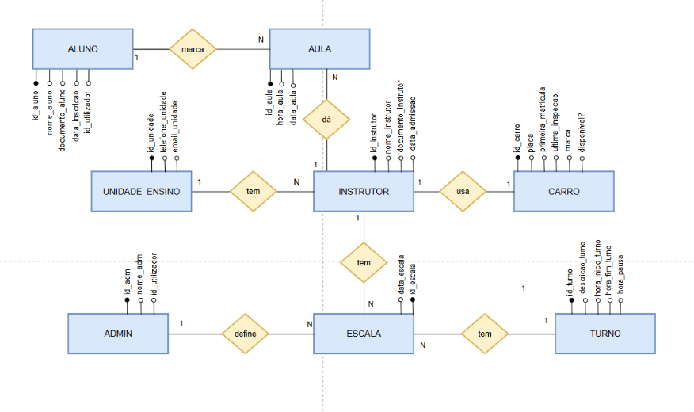
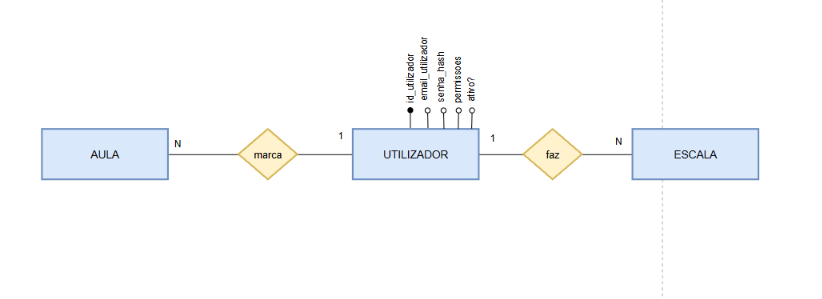

# Regras do negócio:

O *SelfBook* é um sistema gestor de horários de aulas para escolas de condução. nesse sistema:

- As entidades principais são unidade de ensino, aluno, admin, instrutor, aula, escala turno e carro.

- A escola de condução tem 3 **UNIDADES** de ensino em diferentes localidades. Cada unidade é identificada por seu ID, nome, e-mail e telefone (para o nosso sistema não importa guardar o endereço).

- A escola dispõe de carros e cada **CARRO** está associado à um único INSTRUTOR por vez. dos carros importa guardar seu ID, número de matrícula, marca e disponibilidade (pode ser que tenham carros sem instrutores);

- Cada **INSTRUTOR** está associado à uma única unidade de ensino por vez. Do instrutor importa guardar seu próprio ID, o nome, número de documento, a data de admissão, a unidade de ensino e o carro associados à ele (pode ser que existam instrutores sem carro), se está trabalhando (T), de férias (F) ou baixa médica (BM);

- O **ADMIN** faz a ESCALA de trabalho dos INSTRUTORES e todas as unidades de ensino. Também pode adicionar, remover instrutores, trocá-los de unidades de ensino e trocar ou remover carros. Do admiin basta apenas guardar o ID e o nome. Podem existir mais de um admin.

- Exstem 3 **TURNOS** possíveis para os INSTRUTORES, nomeadamente manhã (7h-16h com pausa das 11h às 12h), tarde (9h-18h com pausa das 13h às 14h) e noite (11h-20h com pausa das 15h às 16h);

- a **ESCALA** faz o relacionamento entre os INSTRUTORES e os TURNOS. Ela tem ID próprio e uma escala diz qual instrutor vai fazer qual turno em qual data. Um instrutor não pode fazer mais de um tuno no mesmo dia. Importa guardar quem foi o ADMIN que fez essa escala.

- Os **ALUNOS** marcam AULAs com INSTRUTORES. Do aluno importa guardar o seu próprio ID, o ID_usuário o nome, o numero de documento e a data de inscrição.

- As **AULAS** têm sempre 1h de duração. Das aulas importa guardar a data, a hora de inicio, o aluno que marcou e o instrutor que ele escolheu. Não podem existir duas aulas na mesma data e hora com o mesmo aluno, nem duas aulas na mesma dada e hora com o mesmo instrutor. 

O modelo conceitual ficou assim:

## UTILIZADOR

Do **UTILIZADOR** importa guardar email e senha (hash). Utilizadores podem ter ou permissoes de ADMIN, ou permissões de ALUNO. De momento, o sistema não inclui instrutores como utilizadores. 

Um utilizador corresponde a um único aluno/admin e um aluno/admin corresponde a um único utilizador. um aluno não pode ter permissões de admin e vice versa. 

Na escola podem existir alunos e admins que ainda não são utilziadores. mas nunca vai existir um utilizador que não está associado à um aluno ou a um admin.

Os utilziadores fazem login com email e senha (No protótipo estava login com google, porém mudamos de ideia pois não parece fazer muito sentido um admin fazer login com sua conta pessoal do google.).

Escolhemos por não represenhar a entidade UTILIZADOR no modelo conceptual, pois ao mesclar as duas entidades ALUNO e INSTRUTOR (ambos são utilizadores), o diagrama ficaria visualmente poluído e dificil de entender qual usuário tem permissão de realizar qual ação

(Simplificação de como ficaria)

## Lógica da marcação de aulas para a implementação web

1- de momento o sistema vai servir parar marcação apenas de aulas práticas

2- O aluno não deve consegui marcar aulas com instrutores que estão indisponíveis (seja de folga, férias, baixa médica ou de pausa)

3- O aluno não deve conseguir marcar mais de 4 aulas no mesmo dia, nem mais de 2 aulas seguidas uma da outra, nem marcar aulas para dias que já passaram.

4- O aluno pode desmarcar aulas com no mínimo 24h de antecedência (não pode desmarcar aulas no mesmo dia).

5- O aluno tem limite de aulas (16 aulas práticas). depois que ele marcar todas, não deve conseguir marcar mais.

6- O aluno deve conseguir visualizar todas as aulas já marcadas e os horários disponíveis de cada instrutor.

7- O Admin pode adicionar ou remover instrutores do sistema. também pode trocá-los de unidade de ensino, trocar seus carros e removê-los.

8- O admin deve conseguir visualizar todos os instrutores de todas as unidades, com todas as informações da tabela;

9- O admin deve conseguir visulaizar e modificar a escala te todos os instrutores, separados por unidades de ensino.

10- O admin deve alterar o horário dos instrutores com no mínimo 24h de antecedencia.

# MUDAR RELACIONAMENTO ENTRE USUARIO, ALUNO E ADMIN!!

4. Pode existir um utilizador sem aluno nem admin. A regra diz “nunca vai existir um utilizador que não está associado a um aluno ou a um admin”. Com a estrutura atual, o MySQL não consegue garantir isso, porque a FK aponta de aluno/admin para utilizador e não o contrário. A solução limpa é inverter a ligação:

utilizador passa a ter id_aluno INT NULL UNIQUE e id_admin INT NULL UNIQUE, com FKs para aluno e admin.
Junta CHECK ((id_aluno IS NULL) <> (id_admin IS NULL)), para ter exatamente um dos dois.
Deixam de ser precisos tipo_utilizador e os id_tipo_utilizador em aluno/admin.

Assim também fica garantido que um aluno não tem permissões de admin e vice-versa. Se preferires manter a estrutura atual, tens de documentar que essa regra fica a cargo da aplicação.